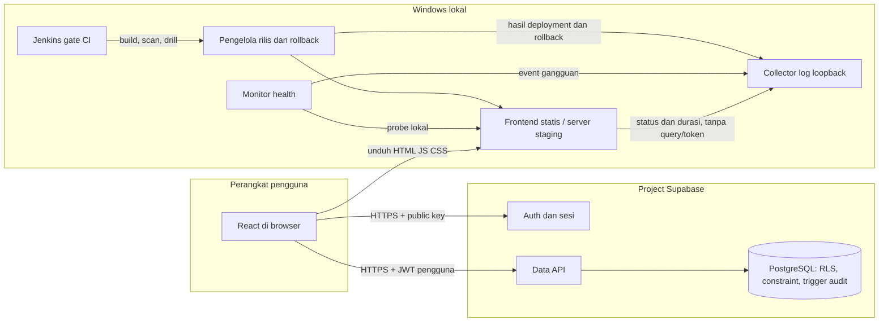

# Arsitektur aplikasi dan batas kepercayaan

Versi aktif: React/TypeScript + Supabase Auth/Data API/PostgreSQL. Express/MySQL
dan Jenkinsfile utama adalah legacy. Alur Git yang disepakati: **ilyas -> PR ke
development** dalam repository Z0J0-hub/Booking_Ruangan-Lab. Tidak diperlukan branch baru.

Browser mengakses Supabase langsung. Server frontend bukan proxy database;
network container internal dapat dibatasi tanpa menghentikan koneksi browser ke
Supabase. Public key frontend bukan secret admin. Credential DB tidak dibutuhkan
untuk build, DAST pasif, scan konfigurasi, atau drill operasi.

| Batas | Risiko | Mitigasi dan bukti |
|---|---|---|
| Browser -> Auth/Data API | Identitas palsu, kebocoran data, kenaikan role | Auth/JWT, RLS, trigger role student; STRIDE SQL 14 skenario pernah lolos di project tes terpisah, bukan bukti project utama identik |
| GitHub -> Jenkins | PR mengubah scanner/Jenkinsfile | PR tidak membawa credential DB; Multibranch masih disabled sampai agent terisolasi; required checks perlu admin |
| HTTP frontend lokal | Metode tulis, path traversal, dotfile | Loopback, GET/HEAD, validasi path dan symlink; tes staging lolos |
| Frontend/monitor -> collector | Injeksi log, PII/token masuk log | Bearer acak per proses, allowlist field, batas payload, tidak mencatat URL/query/body/IP pengguna |
| Artefak -> rilis | Asset rusak atau rilis lama dimodifikasi | Manifest SHA-256, rilis tidak ditimpa, smoke test HTTP asset, rollback otomatis; tes juga menolak rollback ke rilis yang dimodifikasi |

Log lokal hanya mencakup frontend, deployment, dan monitor. Audit database tetap
berada di Supabase; ekspor log Supabase ke SIEM belum diterapkan. Diagram bukan
bukti firewall cloud, backup, TLS hosting, atau kebijakan project sudah diverifikasi.

SDLC: perubahan di ilyas -> review/PR development -> gate source dan IaC -> build
-> DAST -> drill operasi -> archive. Scan exact image ada pada pipeline container
terpisah untuk mesin Docker nanti. Deployment produksi belum diotomatisasi.

Detail ancaman aplikasi: [STRIDE_MATRIX.md](STRIDE_MATRIX.md). Status bukti:
[RUBRIK_STATUS.md](RUBRIK_STATUS.md).
